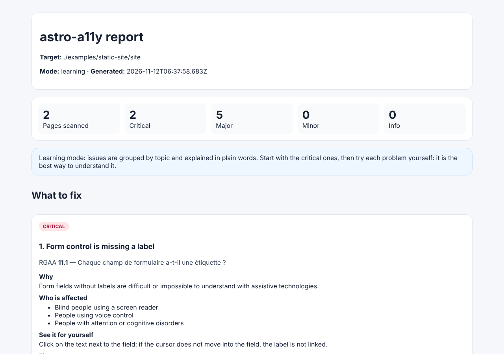

# astro-a11y

[English](./README.md) | Français

[](https://www.npmjs.com/package/astro-a11y)
[](https://nodejs.org)
[](https://accessibilite.numerique.gouv.fr/)

Garde-fous d’accessibilité pour les projets Astro. Porté par [Le Singe du Numérique](https://lesingedunumerique.fr).

> **Sur npm :** [`@astro-a11y/astro-integration`](https://www.npmjs.com/package/@astro-a11y/astro-integration) (intégration Astro) et [`astro-a11y`](https://www.npmjs.com/package/astro-a11y) (CLI). Chaque version est publiée par GitHub Actions, avec la provenance npm (voir [RELEASING.md](./RELEASING.md)).

Les scans tournent dans Chromium via Playwright. Installez le navigateur correspondant une fois par machine avec `npx astro-a11y install-browser` (en CI Linux : `npx astro-a11y install-browser --with-deps`).

`astro-a11y` est une boîte à outils orientée Astro qui scanne les pages rendues avec Playwright + axe, enrichit les résultats avec des recommandations actionnables, mappe les problèmes courants vers le RGAA, et s’exécute via CLI ou automatiquement en fin de build Astro.

## TL;DR (30 secondes)

Nouveau site Astro :

```bash
pnpm create astro@latest mon-site && cd mon-site
pnpm add -D @astro-a11y/astro-integration
# Ajouter l'intégration dans astro.config.mjs (voir Guide débutant)
pnpm astro build
```

Site existant :

```bash
# Projet Astro existant -> intégrer puis build
pnpm add -D @astro-a11y/astro-integration
pnpm astro build

# Ou scan direct d'un build / d'une URL
npx astro-a11y check ./dist --mode balanced
npx astro-a11y check https://example.com --mode paranoid --allowed-domains example.com
```

Rapports : `dist/astro-a11y/` (intégration Astro) ou fichier défini avec `--output` (CLI).

## Démarrage rapide

```bash
pnpm install
pnpm build
pnpm test
pnpm example:scan
```

## Exemple de sortie

Des artefacts d'exemple versionnés issus de `pnpm example:scan` sont disponibles ici :

- [Sortie terminal](./docs/examples/example-terminal.txt)
- [Rapport JSON](./docs/examples/example-report.json)
- [Rapport Markdown](./docs/examples/example-report.md)
- [Rapport HTML](./docs/examples/example-report.html)

Capture du rapport HTML généré :



## Guide débutant

### Cas 1 - Monter un nouveau site Astro avec astro-a11y

1. Créer votre site Astro.
2. Installer l’intégration dans le site.
3. Ajouter l’intégration dans `astro.config.mjs`.
4. Lancer le build et lire le rapport généré.

Exemple :

```bash
# 1) Nouveau projet
pnpm create astro@latest mon-site
cd mon-site

# 2) Dépendance
pnpm add -D @astro-a11y/astro-integration
```

```js
// 3) astro.config.mjs
import { defineConfig } from 'astro/config';
import astroA11y from '@astro-a11y/astro-integration';

export default defineConfig({
  integrations: [
    astroA11y({
      mode: 'balanced',
      failOnBuild: false,
      writeReports: true
    })
  ]
});
```

```bash
# 4) Génération + scan automatique en fin de build
pnpm astro build
```

Par défaut, les rapports sont écrits dans `dist/astro-a11y/`.

### Cas 2 - Brancher astro-a11y à un site existant

Vous avez deux options selon votre contexte :

- Option A : vous avez un projet Astro et vous voulez un scan à chaque build -> utilisez l’intégration Astro.
- Option B : vous avez déjà un site statique ou une URL de préprod/prod -> utilisez la CLI `astro-a11y check`.

Option A (projet Astro existant) :

```bash
pnpm add -D @astro-a11y/astro-integration
```

Ajoutez ensuite la même config que dans le Cas 1, puis :

```bash
pnpm astro build
```

Option B (site déjà déployé ou dossier `dist` existant) :

```bash
# Scan d'un dossier de build local
npx astro-a11y check ./dist --mode balanced

# Scan d'une URL distante (avec garde-fous de domaine)
npx astro-a11y check https://example.com --mode paranoid --allowed-domains example.com
```

### Comprendre les résultats rapidement

- `terminal` : lisible dans la console (par défaut).
- `json` : exploitable en CI.
- `html` : partageable avec des non-tech.
- `markdown` : pratique pour ticketing / PR.

Exemple de génération de rapport HTML :

```bash
npx astro-a11y check ./dist --format json --output reports/report.json
npx astro-a11y report --input reports/report.json --format html --output reports/report.html --safe-report
```

## Modes et échec du build

| Mode | Rôle | Échoue par défaut ? |
| --- | --- | --- |
| `balanced` | Scan par défaut | Non (CLI) · seulement avec `failOnBuild: true` (intégration) |
| `strict` | Même scan, seuil plus exigeant | Oui, dès les problèmes `major` |
| `learning` | Rapport seul, pour les ateliers et les premiers audits : problèmes regroupés par sujet, avec qui est gêné et comment le constater soi-même | Jamais |
| `paranoid` | Scans distants avec les garde-fous les plus stricts (pas de redirection, ports sensibles bloqués, rapports nettoyés) | Non |

Un seuil explicite l'emporte toujours : `--fail-on <sévérité>` (CLI) ou `failOn` (intégration), avec `critical`, `major`, `minor` ou `info`. Un mode ou un seuil invalide est refusé avec une erreur au lieu d'être ignoré en silence.

## Couverture RGAA et rapports en français

87 règles axe-core sont reliées à des critères RGAA 4.1.2 (en plus des 3 tests clavier), chacune avec une explication et une correction en anglais et en français. Les règles sans équivalent RGAA clair (AAA, WCAG 2.2, informatives) sont signalées en `manual-check` avec la sévérité d'axe.

`--lang fr` (CLI), `lang: 'fr'` (intégration) ou `lang: fr` (Action) écrivent les problèmes et les rapports en français.

Chaque rapport se termine par une **vue par critère** : pour chaque critère concerné par les règles exécutées, *Problèmes détectés*, *À vérifier à la main* (axe n'a pas pu trancher), *Aucun problème détecté* ou *Non applicable*. *Aucun problème détecté* veut seulement dire que les tests automatiques n'ont rien trouvé : la plupart des critères demandent aussi une vérification humaine.

## Mode pédagogique (ateliers)

`--mode learning --lang fr` transforme le rapport en support d'atelier, pour une association, une petite mairie ou une équipe non technique :

- un sujet par règle, les plus graves d'abord, expliqué simplement ;
- **qui est gêné** (personnes aveugles avec un lecteur d'écran, personnes qui naviguent au clavier, personnes malvoyantes…) ;
- **le constater soi-même** : une manière simple de vivre le problème (écran en niveaux de gris, clavier seul, lecteur d'écran gratuit…) ;
- la correction avec un exemple avant/après, et toutes les pages et éléments concernés ;
- ce qui fonctionne déjà, et ce qui reste à vérifier à la main.

Il ne fait jamais échouer un build. Le rapport HTML est lui-même vérifié avec axe-core dans les tests.

## Tests clavier

En plus d'axe-core, chaque page est parcourue avec la touche Tab (désactivable avec `--no-keyboard` ou `keyboard: false`) :

| Test | RGAA | Sévérité | Détecte |
| --- | --- | --- | --- |
| `keyboard-trap` | 12.9 | critical | Tab tourne en boucle sur quelques éléments sans jamais atteindre le reste de la page |
| `keyboard-focus-visible` | 10.7 | minor | Un élément reçoit le focus clavier sans contour ni changement de style |
| `keyboard-skip-link` | 12.7 | major | Le premier lien pointe vers une ancre absente, ou son activation ne déplace pas la navigation clavier vers sa cible |

`keyboard-focus-visible` est `minor`, car un changement visible peut rester trop discret, et un indicateur dessiné par un script n'est pas détectable : à confirmer à la main. La cohérence de l'ordre de tabulation (RGAA 12.8) demande toujours un humain.

## Baseline : adopter l'outil sur un site existant

Enregistrez une fois les problèmes actuels, puis n'échouez que sur les nouveaux :

```bash
astro-a11y check ./dist --write-baseline a11y-baseline.json   # fichier à versionner
astro-a11y check ./dist --mode strict --baseline a11y-baseline.json
```

Avec une baseline, les rapports signalent les nouveaux problèmes et comptent les éléments corrigés depuis, et le seuil d'échec ne compte que les nouveaux problèmes. L'intégration Astro accepte le même fichier : `astroA11y({ mode: 'strict', baseline: 'a11y-baseline.json' })` (chemin relatif à la racine du projet).

Un problème est identifié par la règle axe, le chemin de la page et le sélecteur CSS de l'élément. Si le code autour d'un élément change, son sélecteur peut changer aussi : il apparaît alors comme corrigé + nouveau.

## GitHub Action

Analyse un build, publie (et met à jour) un seul commentaire sur la pull request, remplit le résumé du job et joint les rapports HTML/JSON/Markdown :

```yaml
jobs:
  a11y:
    runs-on: ubuntu-latest
    permissions:
      contents: read
      pull-requests: write # pour commenter la pull request
    steps:
      - uses: actions/checkout@v4
      - run: npm ci && npm run build
      - uses: Stan69000/astro-a11y@main # épinglez un tag de version ou un SHA
        with:
          target: dist
          mode: strict
          baseline: a11y-baseline.json
```

Entrées : `target`, `mode`, `fail-on`, `baseline`, `include-tags`, `exclude-rules`, `allowed-domains`, `comment`, `upload-report`, `artifact-name`, `github-token`. Sorties : `report-dir`, `new-issues`, `exit-code`. Sur une pull request venant d'un fork, le jeton est en lecture seule : le commentaire est ignoré avec un avertissement, et le résumé du job contient quand même le rapport.

## CLI

```bash
astro-a11y check <target> [--mode strict|balanced|learning|paranoid] [--format terminal|json|html|markdown|github] [--fail-on critical|major|minor|info] [--baseline <file>] [--sitemap [url]] [--lang en|fr] [--no-keyboard]
astro-a11y report --input ./reports/report.json [--format terminal|json|html|markdown] [--safe-report]
astro-a11y install-browser [--with-deps]
```

Exemples :

```bash
astro-a11y check ./dist --mode balanced
astro-a11y check ./dist --fail-on critical
astro-a11y check ./dist --baseline a11y-baseline.json --format github --output comment.md
astro-a11y check https://example.com --mode paranoid --allowed-domains example.com
astro-a11y check https://example.com --format json --output reports/report.json
astro-a11y report --input reports/report.json --format html --output reports/report.html --safe-report
```

### Analyser tout un site déployé

```bash
astro-a11y check https://example.com --sitemap --max-pages 100 --allowed-domains example.com
astro-a11y check https://example.com --sitemap https://example.com/sitemap-0.xml
```

`--sitemap` lit les sitemaps déclarés dans `robots.txt`, puis `/sitemap-index.xml` (généré par `@astrojs/sitemap`) et `/sitemap.xml`. Il suit les index de sitemaps et ne garde que les pages du même nom d'hôte, dans la limite de `--max-pages` (50 par défaut). Chaque requête passe par les mêmes garde-fous qu'un scan d'URL unique (adresses privées, redirections, liste de domaines autorisés). Une page impossible à charger (HTTP 4xx/5xx, délai dépassé) est listée dans le rapport ; si un seuil d'échec est défini, elle fait échouer l'exécution.

## Intégration Astro

```js
import { defineConfig } from 'astro/config';
import astroA11y from '@astro-a11y/astro-integration';

export default defineConfig({
  integrations: [
    astroA11y({
      mode: 'balanced',
      failOnBuild: false,
      writeReports: true
    })
  ]
});
```

Les rapports sont écrits dans `<dist>/astro-a11y/` par défaut.

Toutes les pages pré-rendues sont analysées, y compris celles générées par des routes dynamiques (`[slug].astro`, `[...path].astro`). Les endpoints (RSS, sitemap…), les redirections et les pages rendues à la demande (SSR) sont ignorés, car ils ne produisent pas de fichier HTML statique.

| Option | Défaut | Description |
| --- | --- | --- |
| `mode` | `'balanced'` | `strict`, `balanced`, `learning` ou `paranoid` (voir plus haut) |
| `failOnBuild` | `false` | Fait échouer le build dès les problèmes `major` |
| `failOn` | — | Seuil d'échec explicite, prioritaire sur le mode |
| `writeReports` | `true` | Écrit les fichiers de rapport |
| `outputDirName` | `'astro-a11y'` | Dossier des rapports, relatif au dossier de build |
| `reportFormats` | `['json', 'html', 'markdown']` | Rapports à écrire |
| `includeTags` | — | Tags axe à exécuter, ex. `['wcag2a', 'wcag2aa']` |
| `excludeRules` | — | Règles axe à ignorer |
| `timeout` | `15000` | Délai de chargement d'une page (ms) |
| `showProgress` | `false` | Affiche chaque page analysée |
| `baseline` | — | Fichier de baseline, relatif à la racine du projet |
| `keyboard` | `true` | Lance les tests clavier |
| `lang` | `'en'` | Langue des problèmes et des rapports (`en`, `fr`) |

## Porté par Le Singe du Numérique

`astro-a11y` est porté par [Le Singe du Numérique](https://lesingedunumerique.fr), association de sensibilisation au numérique et à la cybersécurité. C'est le projet compagnon de [rgaa-audit](https://stan69000.github.io/rgaa-audit/).

Les deux outils partagent le même référentiel RGAA (version 4.1.2, intitulés officiels des 106 critères, générés depuis la source DINUM) : `packages/core/src/rgaa-criteria.cjs` est une copie exacte du fichier de rgaa-audit, synchronisée avec `node scripts/sync-rgaa-reference.js` et vérifiée chaque semaine par le workflow *RGAA reference*.

## Pour la communauté

Le projet est maintenu par une seule personne, et les contributions sont bienvenues.

- Guide de contribution : [CONTRIBUTING.md](./CONTRIBUTING.md)
- Support et attentes : [SUPPORT.md](./SUPPORT.md)
- Direction produit : [ROADMAP.md](./ROADMAP.md)
- Politique sécurité : [SECURITY.md](./SECURITY.md)

## Structure du dépôt

- `packages/core` - moteur de scan, sécurité, mapping RGAA
- `packages/reporters` - reporters terminal, JSON, HTML, Markdown
- `packages/cli` - point d’entrée CLI
- `packages/astro-integration` - intégration Astro
- `examples/static-site` - fixture HTML statique utilisée par `pnpm example:scan`
- `tests` - tests automatiques

## Positionnement sécurité

- Local-first par défaut
- Pas de télémétrie
- Cibles distantes sensibles bloquées sauf autorisation explicite
- Mode paranoid pour scans distants stricts
- Workflow d’audit sécurité dédié
