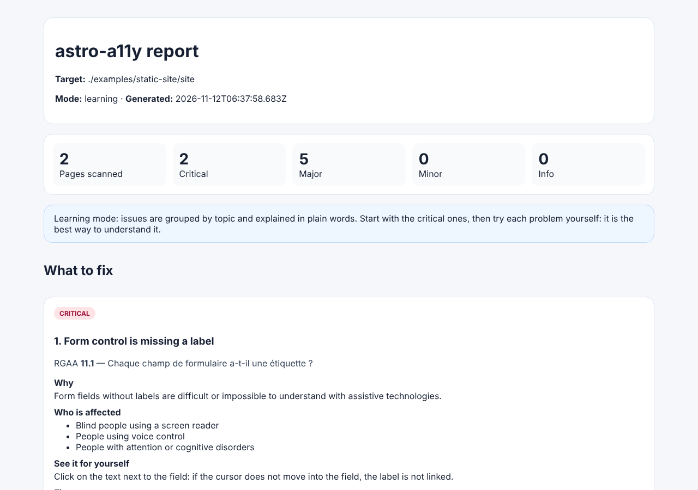

# astro-a11y

English | [Français](./README.fr.md)

[](https://nodejs.org)
[](https://accessibilite.numerique.gouv.fr/)

Accessibility guardrails for Astro projects. Backed by [Le Singe du Numérique](https://lesingedunumerique.fr).

> **Not published on npm yet.** The `pnpm add` / `npx` commands below will work once the packages are released (see [RELEASING.md](./RELEASING.md)). Until then, clone this repository, run `pnpm install && pnpm build`, then use `node packages/cli/dist/bin.js` or import `packages/astro-integration/dist/index.js`.

Scans run in Chromium through Playwright. Install the matching browser once per machine with `npx astro-a11y install-browser` (on Linux CI: `npx astro-a11y install-browser --with-deps`).

`astro-a11y` is an Astro-first accessibility toolkit that scans rendered pages with Playwright + axe, enriches findings with actionable guidance, maps common issues to RGAA criteria, and runs from the CLI or at the end of an Astro build.

## Quick Start

```bash
pnpm install
pnpm build
pnpm test
pnpm example:scan
```

## Example Output

Versioned sample artifacts from `pnpm example:scan` are available in:

- [Terminal output](./docs/examples/example-terminal.txt)
- [JSON report](./docs/examples/example-report.json)
- [Markdown report](./docs/examples/example-report.md)
- [HTML report](./docs/examples/example-report.html)

Screenshot of the generated HTML report:



## Beginner Guide

### Case 1 - Set up a new Astro site with astro-a11y

1. Create your Astro site.
2. Install the integration package.
3. Register the integration in `astro.config.mjs`.
4. Run the build and read the generated report.

Example:

```bash
# 1) New project
pnpm create astro@latest my-site
cd my-site

# 2) Dependency
pnpm add -D @astro-a11y/astro-integration
```

```js
// 3) astro.config.mjs
import { defineConfig } from 'astro/config';
import astroA11y from '@astro-a11y/astro-integration';

export default defineConfig({
  integrations: [
    astroA11y({
      mode: 'balanced',
      failOnBuild: false,
      writeReports: true
    })
  ]
});
```

```bash
# 4) Build + automatic scan at the end of the build
pnpm astro build
```

By default, reports are written to `dist/astro-a11y/`.

### Case 2 - Connect astro-a11y to an existing site

You have two options depending on your setup:

- Option A: you have an Astro project and want scans on every build -> use the Astro integration.
- Option B: you already have a static build or a staging/production URL -> use the `astro-a11y check` CLI.

Option A (existing Astro project):

```bash
pnpm add -D @astro-a11y/astro-integration
```

Then add the same config as in Case 1, and run:

```bash
pnpm astro build
```

Option B (already deployed site or existing `dist` folder):

```bash
# Scan a local build directory
npx astro-a11y check ./dist --mode balanced

# Scan a remote URL (with domain safety guardrails)
npx astro-a11y check https://example.com --mode paranoid --allowed-domains example.com
```

### Read results quickly

- `terminal`: readable in the console (default).
- `json`: CI-friendly format.
- `html`: easy to share with non-technical stakeholders.
- `markdown`: useful for tickets and pull requests.

Example HTML report flow:

```bash
npx astro-a11y check ./dist --format json --output reports/report.json
npx astro-a11y report --input reports/report.json --format html --output reports/report.html --safe-report
```

## Modes and build failure

| Mode | What it does | Fails by default? |
| --- | --- | --- |
| `balanced` | Default scan | No (CLI) · only with `failOnBuild: true` (integration) |
| `strict` | Same scan, stricter gate | Yes, on `major` issues and above |
| `learning` | Report-only, for workshops and first audits | Never |
| `paranoid` | Remote scans with the strictest security guards (no redirects, sensitive ports blocked, sanitized reports) | No |

An explicit threshold always wins: `--fail-on <severity>` (CLI) or `failOn` (integration), with `critical`, `major`, `minor` or `info`. An invalid mode or threshold is rejected with an error instead of being silently ignored.

## Keyboard checks

On top of axe-core, every page is browsed with the Tab key (disable with `--no-keyboard` or `keyboard: false`):

| Check | RGAA | Severity | Detects |
| --- | --- | --- | --- |
| `keyboard-trap` | 12.9 | critical | Tab keeps cycling through a few elements and never reaches the rest of the page |
| `keyboard-focus-visible` | 10.7 | minor | An element gets keyboard focus with no outline and no style change |
| `keyboard-skip-link` | 12.7 | major | The first link points to a missing anchor, or activating it does not move keyboard navigation to its target |

`keyboard-focus-visible` is `minor` because a visible change can still be too faint, and an indicator drawn by a script cannot be detected: confirm it manually. A coherent tab order (RGAA 12.8) still needs a human.

## Baseline: adopt it on an existing site

Record today's issues once, then only fail on issues that are new:

```bash
astro-a11y check ./dist --write-baseline a11y-baseline.json   # commit this file
astro-a11y check ./dist --mode strict --baseline a11y-baseline.json
```

With a baseline, reports mark new issues and count the elements fixed since the baseline, and the failure threshold only counts new issues. The Astro integration accepts the same file: `astroA11y({ mode: 'strict', baseline: 'a11y-baseline.json' })` (path relative to the project root).

An issue is identified by axe rule + page path + CSS selector of the element. If the markup around an element changes, its selector can change too, and it then shows up as fixed + new.

## GitHub Action

Scans a build, posts (and updates) one comment on the pull request, writes the job summary and uploads the HTML/JSON/Markdown reports:

```yaml
jobs:
  a11y:
    runs-on: ubuntu-latest
    permissions:
      contents: read
      pull-requests: write # to comment on the pull request
    steps:
      - uses: actions/checkout@v4
      - run: npm ci && npm run build
      - uses: Stan69000/astro-a11y@main # pin a release tag or commit SHA
        with:
          target: dist
          mode: strict
          baseline: a11y-baseline.json
```

Inputs: `target`, `mode`, `fail-on`, `baseline`, `include-tags`, `exclude-rules`, `allowed-domains`, `comment`, `upload-report`, `artifact-name`, `github-token`. Outputs: `report-dir`, `new-issues`, `exit-code`. On pull requests from forks, the token is read-only: the comment is skipped with a warning and the job summary still holds the report.

## CLI

```bash
astro-a11y check <target> [--mode strict|balanced|learning|paranoid] [--format terminal|json|html|markdown|github] [--fail-on critical|major|minor|info] [--baseline <file>] [--sitemap [url]]
astro-a11y report --input ./reports/report.json [--format terminal|json|html|markdown] [--safe-report]
astro-a11y install-browser [--with-deps]
```

Examples:

```bash
astro-a11y check ./dist --mode balanced
astro-a11y check ./dist --fail-on critical
astro-a11y check ./dist --baseline a11y-baseline.json --format github --output comment.md
astro-a11y check https://example.com --mode paranoid --allowed-domains example.com
astro-a11y check https://example.com --format json --output reports/report.json
astro-a11y report --input reports/report.json --format html --output reports/report.html --safe-report
```

### Scan a whole deployed site

```bash
astro-a11y check https://example.com --sitemap --max-pages 100 --allowed-domains example.com
astro-a11y check https://example.com --sitemap https://example.com/sitemap-0.xml
```

`--sitemap` reads the sitemaps declared in `robots.txt`, then `/sitemap-index.xml` (written by `@astrojs/sitemap`) and `/sitemap.xml`, follows sitemap indexes and keeps only pages on the same hostname, up to `--max-pages` (default 50). Every request goes through the same guards as a single-URL scan (private addresses, redirects, allowlist). A page that cannot be loaded (HTTP 4xx/5xx, timeout) is listed in the report; when a failure threshold is set, it makes the run fail.

## Astro Integration

```js
import { defineConfig } from 'astro/config';
import astroA11y from '@astro-a11y/astro-integration';

export default defineConfig({
  integrations: [
    astroA11y({
      mode: 'balanced',
      failOnBuild: false,
      writeReports: true
    })
  ]
});
```

Reports are written to `<dist>/astro-a11y/` by default.

Every prerendered page is scanned, including pages generated by dynamic routes (`[slug].astro`, `[...path].astro`). Endpoints (RSS, sitemap…), redirects and on-demand (SSR) pages are skipped because they have no static HTML file.

| Option | Default | Description |
| --- | --- | --- |
| `mode` | `'balanced'` | `strict`, `balanced`, `learning` or `paranoid` (see above) |
| `failOnBuild` | `false` | Fail the build on `major` issues and above |
| `failOn` | — | Explicit failure threshold, overrides the mode |
| `writeReports` | `true` | Write report files |
| `outputDirName` | `'astro-a11y'` | Report directory, relative to the build output |
| `reportFormats` | `['json', 'html', 'markdown']` | Report files to write |
| `includeTags` | — | axe tags to run, e.g. `['wcag2a', 'wcag2aa']` |
| `excludeRules` | — | axe rule IDs to skip |
| `timeout` | `15000` | Page load timeout (ms) |
| `showProgress` | `false` | Log each scanned page |
| `baseline` | — | Baseline file, relative to the project root |
| `keyboard` | `true` | Run the keyboard checks |

## Backed by Le Singe du Numérique

`astro-a11y` is carried by [Le Singe du Numérique](https://lesingedunumerique.fr), a French non-profit that raises awareness about digital literacy and cybersecurity. It is the companion project of [rgaa-audit](https://stan69000.github.io/rgaa-audit/).

Both tools share the same RGAA reference (version 4.1.2, official titles of the 106 criteria, generated from the DINUM source): `packages/core/src/rgaa-criteria.cjs` is an exact copy of rgaa-audit's file, kept in sync with `node scripts/sync-rgaa-reference.js` and checked every week by the *RGAA reference* workflow.

## For Contributors

This project is maintained by one person, with community contributions welcome.

- Contributing guide: [CONTRIBUTING.md](./CONTRIBUTING.md)
- Support & expectations: [SUPPORT.md](./SUPPORT.md)
- Project direction: [ROADMAP.md](./ROADMAP.md)
- Security policy: [SECURITY.md](./SECURITY.md)

## Repository Layout

- `packages/core` - scanning engine, security guards, RGAA mapping
- `packages/reporters` - terminal, JSON, HTML, Markdown reporters
- `packages/cli` - CLI entrypoint
- `packages/astro-integration` - Astro integration package
- `examples/static-site` - static HTML fixture used by `pnpm example:scan`
- `tests` - automated tests

## Security Stance

- Local-first by default
- No telemetry
- Unsafe remote targets blocked unless explicitly allowed
- Paranoid mode for strict remote scans
- Dedicated security audit workflow
